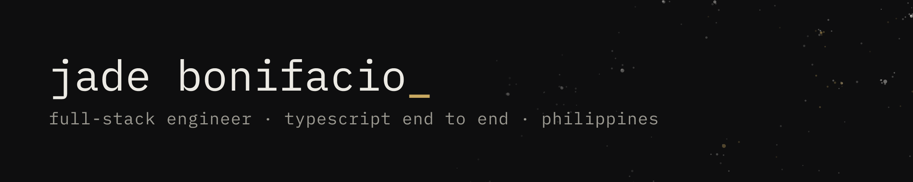

<a href="https://jadebonifacio.dev">
  <picture>
    <source media="(prefers-color-scheme: dark)" srcset="https://raw.githubusercontent.com/Jadesuuu/Jadesuuu/HEAD/assets/banner-dark.png">
    <source media="(prefers-color-scheme: light)" srcset="https://raw.githubusercontent.com/Jadesuuu/Jadesuuu/HEAD/assets/banner-light.png">
    
  </picture>
</a>

Full-stack engineer in the Philippines. TypeScript end to end: React, Node, Next.js, NestJS, Postgres, Redis.

R&D engineer at Advanced World Solutions by day. After hours I build complete products of my own and put them in front of real users. I also build agent tooling on Claude Code, including my team's internal tooling.

I write down what broke. The day job, Reel, JF & The World and ScoutBoard each have a case study on [jadebonifacio.dev](https://jadebonifacio.dev) covering what it does, what failed, and how I fixed it.

## The day job

**Legacy platform modernization.** Two years shipping into a 460-screen Japanese property platform, a C#/Java desktop system rebuilt as a React + TypeScript and Node/Express web app over the same Oracle database, on a 60+ engineer bilingual EN/JP team. The client is under NDA. The numbers are mine.

- **213** UAT defects shipped with zero sent back, **17.5%** of all defects across the programme
- **top 3** defect resolver on the 11-engineer UAT team, **#1** in Q3 2026
- **204** pull requests merged at 97% acceptance, with fixes or features on **262** screens
- **22** shared UI controls fixed at the root, each fix closing issues on 30+ screens
- **6** Claude Code tools the team uses daily, cutting fix verification from ~15 min to under 1 min

[The shape of the work](https://jadebonifacio.dev/work/enterprise-platform-work)

**vTD (Virtual Team Desk), since Oct 2026.** A video desktop app that puts remote teammates at one virtual desk. I designed a 13-step agent pipeline in Claude Code that takes features from requirements to merged code, with an auditor agent that must approve each change before merge. I also built the camera privacy modes, from blur to a face-tracked 3D avatar, so no raw video leaves the device while one is on.

React · TypeScript · Go · WebRTC

## What I've built

**[Reel](https://github.com/Jadesuuu/Reel)** · [case study](https://jadebonifacio.dev/work/reel) · [demo](https://reel.jadebonifacio.dev)

The job-hunt tracker I built for my own search. It pulls from 10 job boards every 6 hours, scores postings against my criteria, and tracks applications from Saved to Offer. Each failing source retries on its own queue, and reminder emails can't send twice. 170+ tests in CI. Built with Claude Code; I can walk through every module.

NestJS · Next.js · PostgreSQL · Prisma · BullMQ

**[JF & The World](https://github.com/Jadesuuu/jf-and-the-world)** · [case study](https://jadebonifacio.dev/work/jf-and-the-world) · [demo](https://jfdemo.jadebonifacio.dev)

Live in production with its two intended users: a private map of where we've been and where we want to go, where a pin moves from dream to memory. Realtime sync, magic-link auth, installable as a PWA with push. Access control lives in Postgres row-level security, so there is no API layer to keep in step with the database.

Next.js 15 · Supabase · Mapbox GL · TanStack Query

**[ScoutBoard](https://github.com/Jadesuuu/scoutboard)** · [case study](https://jadebonifacio.dev/work/scoutboard) · [demo](https://scoutboard.jadebonifacio.dev)

A realtime marketplace for buying and selling small businesses, built in five evenings on a stack I learned that week. Cache-aside over listing reads, invalidated on every write path that changes their inputs; offers landing over websockets; an AI endpoint returning structured data; tests green in CI.

NestJS · MongoDB · Redis · Socket.IO · OpenAI

**[HTTP Monitor](https://github.com/Jadesuuu/http-monitor)**

An endpoint monitor and a companion to ScoutBoard: cron-driven checks, live updates over Socket.IO, an AI summary of what failed.

NestJS · Redis · Socket.IO

## Credentials

B.S. Computer Science, Saint Louis University, cum laude, 2024 &nbsp;·&nbsp; AWS Cloud Practitioner &nbsp;·&nbsp; JLPT N4 &nbsp;·&nbsp; PhilNITS FE &nbsp;·&nbsp; TOPCIT

---

Looking for a remote full-stack role on a small team in the TypeScript ecosystem, where I own features end to end and the codebase is still young enough that decisions matter. Based in the Philippines, UTC+8.

[jadebonifacio.dev](https://jadebonifacio.dev) &nbsp;·&nbsp; [jade@jadebonifacio.dev](mailto:jade@jadebonifacio.dev) &nbsp;·&nbsp; [résumé](https://jadebonifacio.dev/resume.pdf) &nbsp;·&nbsp; [LinkedIn](https://www.linkedin.com/in/jade-mark-angelo-bonifacio-169b95288/)
